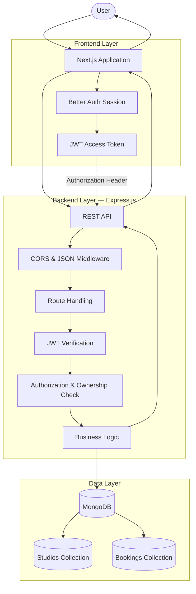
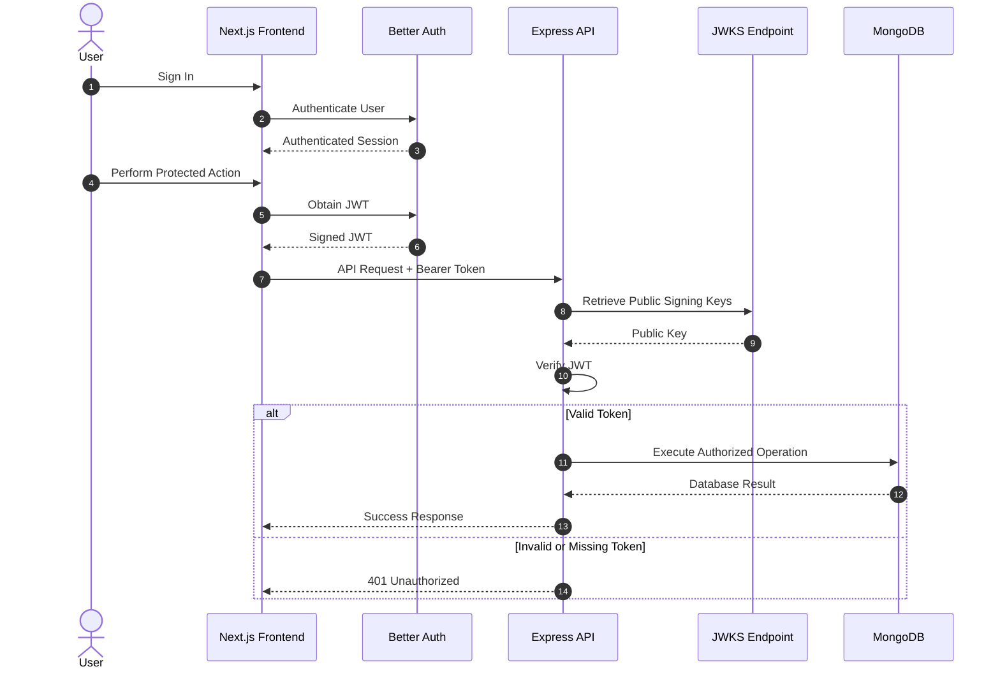
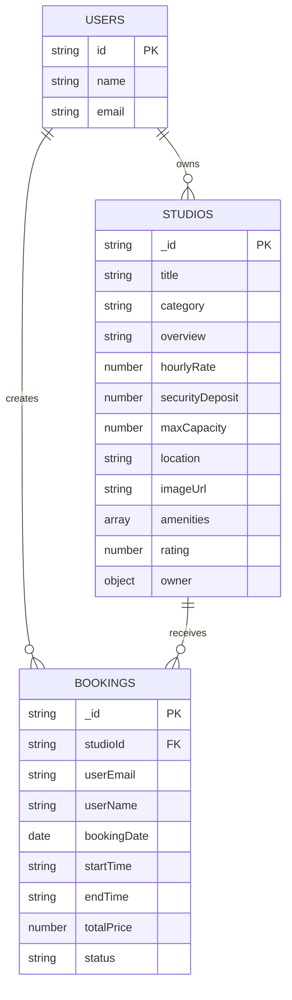
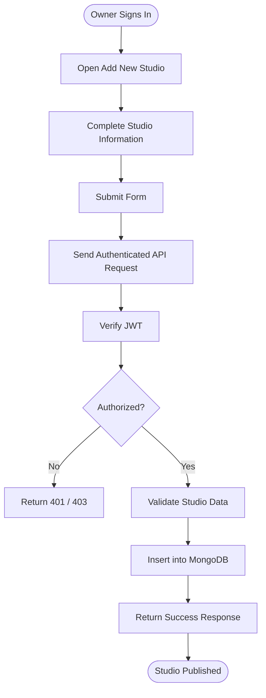
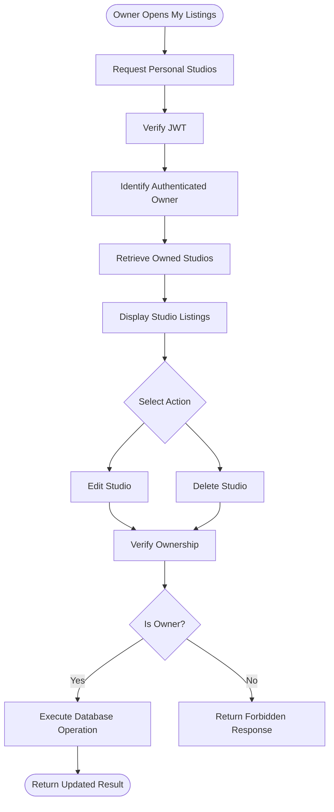
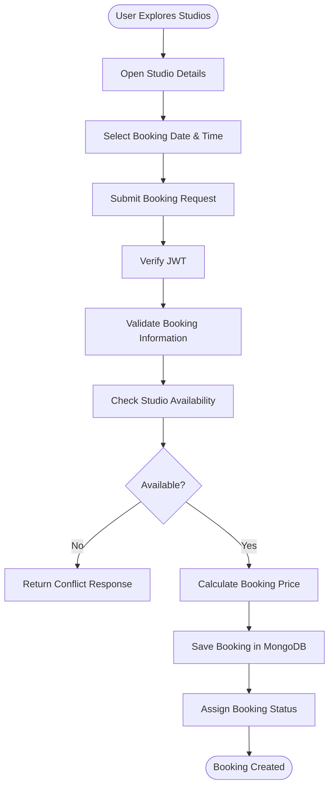
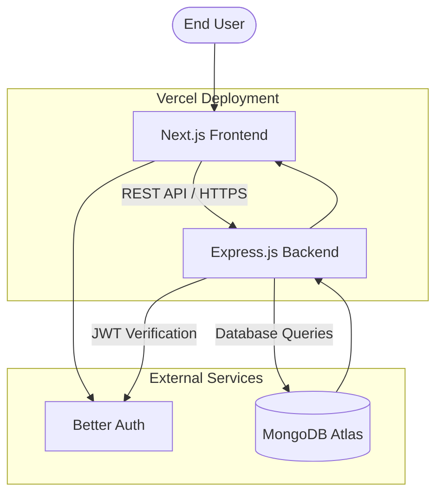

# StudioSpace — Backend

**A Creative Workspace & Studio Sharing Marketplace**

StudioSpace is a full-stack marketplace platform that connects creative professionals with workspace owners. It allows users to discover creative spaces, publish studio listings, manage their studios, and book suitable workspaces for their creative projects.

This repository contains the backend application responsible for API management, database operations, authentication verification, authorization, studio management, and booking-related operations.

---

## System Overview

StudioSpace follows a client-server architecture where the Next.js frontend communicates with an Express.js REST API. The backend processes incoming requests, verifies user authentication, performs authorization checks, interacts with MongoDB, and returns structured JSON responses.

### Technology Stack

| Technology | Purpose |
|---|---|
| Node.js | JavaScript runtime |
| Express.js | REST API development |
| MongoDB | NoSQL database |
| MongoDB Native Driver | Database operations |
| Better Auth | Authentication provider |
| JWT | Secure identity verification |
| jose | JWT verification and JWKS handling |
| CORS | Cross-origin request handling |
| dotenv | Environment configuration |
| Vercel | Backend deployment |

---

## System Architecture

The application uses a layered request-processing architecture.



### Request Lifecycle

1. A user interacts with the Next.js frontend.
2. The frontend obtains the authenticated user's session and JWT.
3. The frontend sends an HTTP request to the Express.js backend.
4. Express middleware processes the request.
5. Protected endpoints verify the JWT using the JWKS public key.
6. Authorization checks ensure that the user has permission to perform the requested operation.
7. Business logic executes the requested operation.
8. MongoDB handles the required database operation.
9. The backend returns a JSON response to the frontend.

---

## Authentication & Security Architecture

StudioSpace uses Better Auth for user authentication and JWT-based verification for securing backend API requests.

Instead of trusting user information received directly from the frontend, the backend independently verifies the JWT before allowing access to protected resources.

### Authentication Flow



### JWT Verification

The backend uses the `jose` library to verify JWT signatures using a remote JSON Web Key Set (JWKS).

Key responsibilities:

- Extract the JWT from the Authorization header.
- Retrieve the appropriate public signing key.
- Verify the token signature.
- Validate token claims such as expiration.
- Extract the verified user identity.
- Reject invalid or expired tokens.

### Authorization

Authentication confirms who the user is. Authorization determines what the user is allowed to do.

StudioSpace applies ownership-based authorization to protected operations.

| Operation | Authorization |
|---|---|
| Browse studios | Public |
| View studio details | Public |
| Add a new studio | Authenticated user |
| View personal listings | Authenticated owner |
| Update a studio | Studio owner only |
| Delete a studio | Studio owner only |
| Create a booking | Authenticated user |
| Access personal bookings | Booking owner only |

**Important:** JWT verification alone does not grant ownership permissions. The backend must compare the verified user's identity with the relevant studio or booking owner before executing protected operations.

---

## Database Architecture

StudioSpace uses MongoDB as its primary database.

The backend organizes application data into separate collections based on their responsibilities.

### Database Relationship Diagram



*The diagram represents the logical data relationships. Actual stored fields depend on the implemented collection schema.*

### Main Collections

**1. Studios**

Stores workspace information published by studio owners.

Main data includes:

- Studio title and category
- Description and overview
- Hourly rental rate
- Security deposit
- Maximum capacity
- Studio location
- Studio image
- Available amenities
- Rating information
- Owner information

**2. Bookings**

Stores workspace reservation information.

Main responsibilities:

- Associate a booking with a studio.
- Identify the booking user.
- Store the selected date and time.
- Maintain booking pricing information.
- Track booking status.

**3. Users**

User authentication and session management are handled through Better Auth. The authentication provider maintains its own user-related records.

---

## Core Application Workflows

### 1. Studio Listing Workflow



### 2. Studio Management Workflow



### 3. Booking Workflow



*Availability checking, duplicate prevention, and status transitions should be enforced by the backend to ensure reliable booking operations.*

---

## API Documentation

The backend exposes RESTful API endpoints for studio discovery, studio management, and booking operations.

### Base URL

```text
https://studiospace-backend-tawny.vercel.app
```

### Studio APIs

| Method | Endpoint | Access | Description |
|---|---|---|---|
| GET | `/studios` | Public | Retrieve studio listings |
| GET | `/studio/:id` | Public | Retrieve a specific studio |
| POST | `/add-new-studio` | Protected | Create a new studio listing |
| PATCH | `/studio/:id` | Protected | Update a studio listing |
| DELETE | `/studio/:id` | Protected | Delete a studio listing |

### Booking APIs

| Method | Endpoint | Access | Description |
|---|---|---|---|
| POST | `/bookings` | Protected | Create a new booking |
| GET | `/my-bookings` | Protected | Retrieve personal bookings |
| PATCH | `/booking/:id` | Protected | Update booking status |
| DELETE | `/booking/:id` | Protected | Cancel or remove a booking |

*Endpoint names should match the actual Express route definitions. Only document routes that are implemented and mounted in the deployed application.*

### Protected Request Example

```http
POST /add-new-studio
Content-Type: application/json
Authorization: Bearer <JWT_TOKEN>
```

Example request body:

```json
{
  "title": "Creative Photography Studio",
  "category": "Photo Studio",
  "hourlyRate": 1200,
  "securityDeposit": 2000,
  "maxCapacity": 10,
  "location": "Dhaka, Bangladesh",
  "imageUrl": "https://example.com/studio.jpg",
  "amenities": [
    "Lighting Equipment",
    "Air Conditioning",
    "Wi-Fi"
  ],
  "overview": "A professional photography workspace.",
  "owner": {
    "name": "Studio Owner",
    "email": "owner@example.com"
  }
}
```

The backend should use the verified JWT identity as the source of truth for the owner rather than trusting the owner identity supplied in the request body.

---

## Project Structure

```text
studiospace-server/
│
├── index.js
├── package.json
├── package-lock.json
├── .gitignore
├── .env
│
└── README.md
```

### File Responsibilities

| File | Responsibility |
|---|---|
| `index.js` | Express server, middleware, API routes, JWT verification, MongoDB connection |
| `package.json` | Project metadata, dependencies, and scripts |
| `package-lock.json` | Dependency version locking |
| `.gitignore` | Excludes sensitive and unnecessary files |
| `.env` | Stores environment-specific configuration |
| `README.md` | Backend documentation |

---

## Environment Configuration

Create a `.env` file in the root directory.

```env
PORT=8000
MONGODB_URI=your_mongodb_connection_string
BETTER_AUTH_URL=your_better_auth_base_url
```

**Security Notice:**

- Never commit `.env` to GitHub.
- Never expose MongoDB credentials.
- Never share private JWT signing keys.
- Use environment variables for production configuration.
- Keep authentication verification on the backend.

---

## Installation & Local Setup

### Prerequisites

Make sure the following are installed:

- Node.js
- npm
- MongoDB database
- Git

### 1. Clone the Repository

```bash
git clone <repository-url>
```

### 2. Navigate to the Project Directory

```bash
cd studiospace-server
```

### 3. Install Dependencies

```bash
npm install
```

### 4. Configure Environment Variables

Create a `.env` file and configure the required environment variables.

### 5. Start the Development Server

```bash
npm run dev
```

### 6. Start the Production Server

```bash
npm start
```

The backend runs on the configured port.

---

## Error Handling & HTTP Status Codes

The API uses standard HTTP response codes to communicate request outcomes.

| Status Code | Meaning |
|---|---|
| 200 | Request successful |
| 201 | Resource successfully created |
| 400 | Invalid request data |
| 401 | Unauthorized or invalid authentication |
| 403 | Forbidden operation |
| 404 | Requested resource not found |
| 409 | Resource conflict |
| 500 | Internal server error |

Responses should follow a consistent JSON structure.

**Success Response**

```json
{
  "success": true,
  "message": "Studio created successfully.",
  "data": {}
}
```

**Error Response**

```json
{
  "success": false,
  "message": "Unauthorized access."
}
```

---

## Security Considerations

StudioSpace follows several backend security principles:

- JWT-based authentication verification.
- Remote JWKS-based public key verification.
- Protected API endpoints.
- Ownership-based authorization.
- Environment-based secret management.
- CORS configuration.
- Server-side validation of incoming data.
- MongoDB operations using validated identifiers.
- Consistent error responses without exposing sensitive server information.

---

## Deployment Architecture

The backend is deployed independently from the frontend.



### Deployment Responsibilities

| Component | Responsibility |
|---|---|
| Frontend | User interface and application interactions |
| Backend | API processing and business logic |
| Better Auth | User authentication and session management |
| MongoDB | Persistent application data |
| Vercel | Backend hosting and deployment |

---

## Future Improvements

Potential improvements for the platform include:

- Advanced studio search and filtering.
- Pagination and optimized database queries.
- Transaction-safe booking management.
- Automated booking conflict prevention.
- Studio availability calendar.
- Review and rating management.
- Image upload and storage integration.
- API rate limiting and request validation.
- Centralized logging and monitoring.

---

## Project Information

**Project Name:** StudioSpace  
**Project Type:** Full-Stack Marketplace Application  
**Backend:** Node.js & Express.js  
**Database:** MongoDB  
**Authentication:** Better Auth & JWT  
**Deployment:** Vercel

StudioSpace aims to simplify creative workspace discovery and booking by providing a centralized platform for studio owners and creative professionals.

---

**Built with purpose. Designed for creators.**