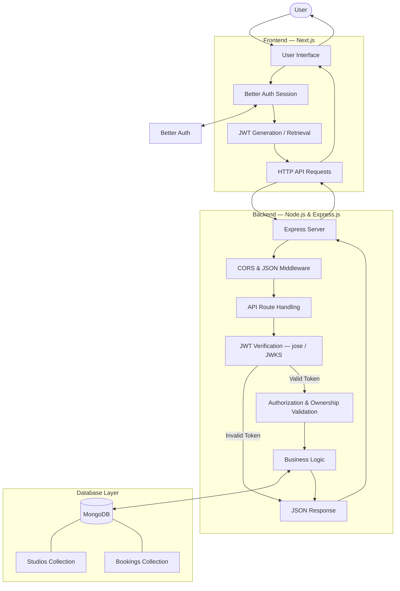

# StudioSpace — Backend

**A Creative Workspace & Studio Sharing Marketplace**

StudioSpace is a creative workspace marketplace that connects studio owners with creative professionals. It enables users to explore available studios, publish workspace listings, manage their properties, and book suitable spaces for creative projects.

This repository contains the backend application responsible for REST API management, authentication verification, authorization, database operations, studio management, and booking services.

## Technology Stack

| Technology | Purpose |
|---|---|
| Node.js | JavaScript Runtime |
| Express.js | Backend Framework |
| MongoDB | NoSQL Database |
| MongoDB Native Driver | Database Operations |
| Better Auth | User Authentication |
| JWT | Secure Identity Verification |
| jose | JWT Verification & JWKS |
| CORS | Cross-Origin Resource Sharing |
| Vercel | Deployment Platform |

---

## System Architecture

StudioSpace follows a client-server architecture. The Next.js frontend communicates with the Express.js backend through RESTful APIs. The backend verifies authenticated requests, applies authorization rules, executes business logic, and interacts with MongoDB.

### Complete System Flow



### Request Processing Flow

1. Users interact with the Next.js frontend.
2. Better Auth handles user authentication and session management.
3. The frontend obtains the JWT for protected operations.
4. API requests are sent to the Express backend.
5. The backend verifies the JWT using the JWKS public key.
6. Authorization checks determine whether the authenticated user can perform the requested operation.
7. Business logic processes the request.
8. MongoDB performs the required database operation.
9. The backend returns a JSON response to the frontend.

---

## Core Features

### Studio Management
- Retrieve all available studio listings.
- View individual studio details.
- Publish new studio listings.
- Update existing studio information.
- Delete studio listings.
- Retrieve listings belonging to authenticated owners.

### Booking Management
- Create studio booking requests.
- Retrieve personal booking information.
- Manage booking status.
- Associate bookings with specific studios and users.
- Validate booking operations.

### Authentication & Authorization
- JWT-based request authentication.
- Remote JWKS public key verification.
- Protected API endpoints.
- Ownership-based access control.
- Secure user identity verification.

---

## Authentication & Authorization

StudioSpace uses Better Auth for authentication and JWT for backend identity verification.

The backend does not blindly trust user information provided by the frontend. Instead, it independently verifies the JWT before allowing access to protected resources.

### JWT Verification Process

1. Extract the Bearer token from the Authorization header.
2. Retrieve the signing public key through JWKS.
3. Verify the JWT signature using `jose`.
4. Validate the token claims and expiration.
5. Extract the authenticated user's identity.
6. Allow or reject the request based on authentication and authorization rules.

### Access Control

| Operation | Access |
|---|---|
| Explore Studios | Public |
| View Studio Details | Public |
| Add New Studio | Authenticated |
| Update Studio | Studio Owner |
| Delete Studio | Studio Owner |
| View My Listings | Authenticated Owner |
| Create Booking | Authenticated |
| View My Bookings | Authenticated User |

---

## API Documentation

The backend provides RESTful endpoints for studio discovery, listing management, and booking operations.

### Studio Endpoints

| Method | Endpoint | Access | Description |
|---|---|---|---|
| GET | `/studios` | Public | Retrieve all studios |
| GET | `/studio/:id` | Public | Retrieve studio details |
| POST | `/add-new-studio` | Protected | Create a studio listing |
| PATCH | `/studio/:id` | Protected | Update a studio |
| DELETE | `/studio/:id` | Protected | Delete a studio |

### Booking Endpoints

| Method | Endpoint | Access | Description |
|---|---|---|---|
| POST | `/bookings` | Protected | Create a booking |
| GET | `/my-bookings` | Protected | Retrieve personal bookings |
| PATCH | `/booking/:id` | Protected | Update booking status |
| DELETE | `/booking/:id` | Protected | Cancel a booking |

*Endpoint names should reflect the actual implemented Express routes.*

### Protected API Request

```http
POST /add-new-studio
Content-Type: application/json
Authorization: Bearer <JWT_TOKEN>
```

---

## Database Overview

StudioSpace uses MongoDB to store and manage application data.

### Studios Collection

Stores studio listing information, including:

- Studio title and category
- Description and overview
- Hourly rental rate
- Security deposit
- Maximum capacity
- Location
- Studio image
- Available amenities
- Rating information
- Owner information

### Bookings Collection

Stores booking-related information, including:

- Studio reference
- Booking user information
- Selected booking date
- Start and end time
- Total booking price
- Booking status

User authentication records are managed through Better Auth.

---

## Project Structure

```text
studiospace-server/
│
├── index.js
├── package.json
├── package-lock.json
├── .gitignore
│
└── README.md
```

### File Responsibilities

| File | Description |
|---|---|
| `index.js` | Express server, API endpoints, authentication verification, and MongoDB operations |
| `package.json` | Project metadata, dependencies, and scripts |
| `package-lock.json` | Dependency version management |
| `.gitignore` | Excludes unnecessary project files |
| `README.md` | Backend documentation |

---

## Installation & Local Setup

### Prerequisites

- Node.js
- npm
- MongoDB
- Git

### 1. Clone the Repository

```bash
git clone <repository-url>
```

### 2. Navigate to the Project

```bash
cd studiospace-server
```

### 3. Install Dependencies

```bash
npm install
```

### 4. Start Development Server

```bash
npm run dev
```

### 5. Start Production Server

```bash
npm start
```

---

## HTTP Status Codes

| Status Code | Description |
|---|---|
| 200 | Request successful |
| 201 | Resource created successfully |
| 400 | Invalid request |
| 401 | Unauthorized |
| 403 | Forbidden |
| 404 | Resource not found |
| 409 | Resource conflict |
| 500 | Internal server error |

---

## Security Practices

- JWT-based authentication verification.
- JWKS-based public key validation.
- Protected API endpoints.
- Ownership-based authorization.
- Server-side request validation.
- Secure MongoDB operations.
- Proper HTTP status codes and error responses.
- Separation of authentication and authorization responsibilities.

---

## Future Improvements

- Advanced studio filtering and search.
- Pagination and query optimization.
- Improved booking availability management.
- Automated booking conflict prevention.
- Studio reviews and ratings.
- Image upload integration.
- API rate limiting.
- Centralized logging and monitoring.

---

## Project Information

| Attribute | Details |
|---|---|
| Project | StudioSpace |
| Type | Full-Stack Marketplace |
| Backend | Node.js & Express.js |
| Database | MongoDB |
| Authentication | Better Auth & JWT |
| Deployment | Vercel |

**StudioSpace — Built for creators, designed for collaboration.**